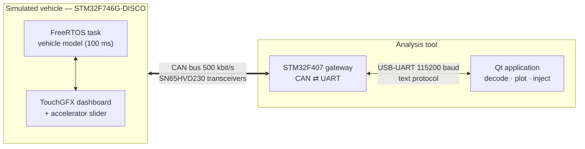
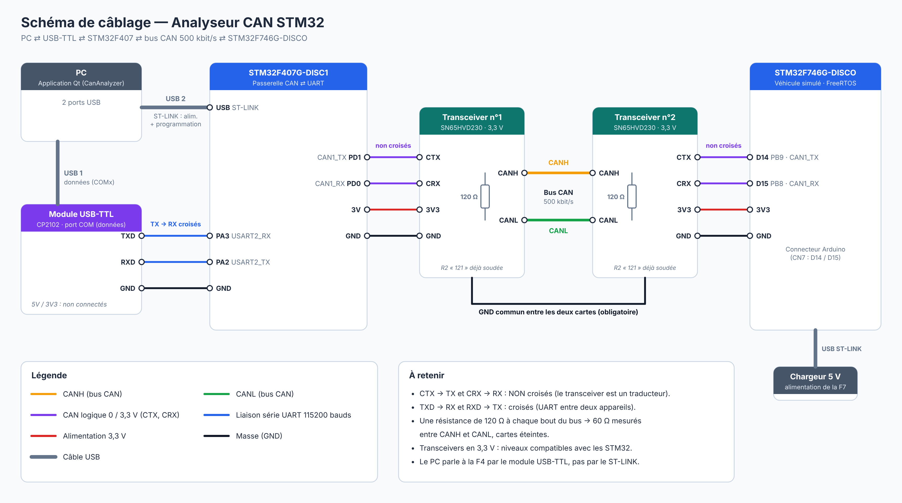

# CAN Bus Analyzer & Vehicle Emulator — STM32 + Qt

A home-made **CANalyzer-like tool**: monitor, decode and inject CAN frames from a PC, tested on a **simulated vehicle ECU** running FreeRTOS with a TouchGFX touchscreen dashboard.

> Mini-project — ING-ISEOC 3 · *Conception de systèmes embarqués connectés*

---

## Overview

The system reproduces, on a desk, what an automotive engineer does when plugging a CAN interface into a car:

| In this project | Real-world equivalent |
|---|---|
| **STM32F746G-DISCO** (FreeRTOS + TouchGFX) | The **vehicle**: engine / ABS / battery / body ECUs + instrument cluster |
| Touchscreen slider | Accelerator pedal |
| **STM32F407G-DISC1** + SN65HVD230 | The **CAN interface** plugged into the OBD port (like a Vector / PEAK adapter) |
| **Qt desktop app** | The engineer's **analysis software** (like Vector CANalyzer) |



## Features

**PC application (C++ / Qt 6)**
- Live dashboard: speed, RPM, coolant temperature, battery voltage, fuel level
- Real-time charts (last 30 s) drawn with `QPainter`
- Raw frame stream with **signal decoding**, ID display filter and pause
- "One row per ID" view with frame counter, **measured period** and change highlighting
- Manual frame injection + one-click headlight commands

**CAN gateway — STM32F407 (C, HAL)**
- Interrupt-driven CAN reception into a **lock-free ring buffer** (single producer / single consumer)
- Interrupt-driven UART command parser with input validation
- Accept-all hardware filter (an analyzer must see everything)
- Automatic bus-off recovery and retransmission

**Simulated vehicle — STM32F746G-DISCO (C/C++, FreeRTOS, TouchGFX)**
- Periodic vehicle model task (`osDelayUntil`, 100 ms): speed ramps, 5-gear RPM model, engine warm-up, alternator voltage, fuel consumption
- Publishes frames on the bus, receives the headlight command through a **hardware ID filter** (0x500 only)
- 480×272 touchscreen dashboard (TouchGFX, MVP pattern), thread-safe access to the shared vehicle state

## CAN message set

All frames: standard 11-bit IDs, 500 kbit/s, big-endian multi-byte values.

| ID | Sender | Period | Payload | Meaning |
|---|---|---|---|---|
| `0x100` | Vehicle | 100 ms | `RPM_H RPM_L TEMP+40` | Engine speed (rpm), coolant temperature (°C, offset 40) |
| `0x200` | Vehicle | 100 ms | `SPEED` | Vehicle speed (km/h) |
| `0x300` | Vehicle | 1 s | `V_H V_L FUEL` | Battery voltage (1/100 V), fuel level (%) |
| `0x500` | Tool (PC) | on demand | `CMD` | Headlight command (00 off, 01 on) |

## Serial protocol (gateway ⇄ PC)

Human-readable text lines, so the gateway can also be tested with any serial terminal (PuTTY).

| Direction | Format | Example |
|---|---|---|
| Gateway → PC | `R <id> <dlc> <bytes…>` | `R 100 3 03 20 82` |
| PC → Gateway | `T <id> <dlc> <bytes…>` | `T 500 1 01` |
| Gateway → PC | `# OK T <id>` / `# ERR <reason>` | `# OK T 500` |

## Hardware

- STM32F407G-DISC1 (CAN gateway) and STM32F746G-DISCO (vehicle)
- 2 × SN65HVD230 CAN transceiver modules (3.3 V, 120 Ω termination on board)
- CP2102 USB-to-UART adapter



| From | To |
|---|---|
| F4 `PD1 (CAN1_TX)` / `PD0 (CAN1_RX)` | Transceiver 1 `CTX` / `CRX` |
| F7 `PB9 (D14)` / `PB8 (D15)` | Transceiver 2 `CTX` / `CRX` |
| Transceiver 1 `CANH` / `CANL` | Transceiver 2 `CANH` / `CANL` |
| CP2102 `TXD` / `RXD` | F4 `PA3` / `PA2` (USART2) |
| All `GND` | Common ground |

## CAN bit timing

| Board | APB1 clock | Prescaler | BS1 | BS2 | Time quanta / bit | Bit rate | Sample point |
|---|---|---|---|---|---|---|---|
| F407 | 42 MHz | 6 | 11 | 2 | 14 | 500 kbit/s | 85.7 % |
| F746 | 54 MHz | 6 | 15 | 2 | 18 | 500 kbit/s | 88.9 % |

## Repository structure

```
firmware/
  F4_can_gateway/        STM32CubeIDE project (gateway)
  F7_vehicle_touchgfx/   STM32CubeIDE + TouchGFX project (vehicle)
pc-app/
  CanAnalyzer/           Qt 6 / CMake desktop application
docs/                    Photos, demo, diagrams
```

Generated folders are not included (`Drivers/`, `Middlewares/`, `TouchGFX/generated/`):
open the `.ioc` file with STM32CubeMX and the `.touchgfx` file with TouchGFX Designer, then click **Generate Code** to recreate them.

## Build & run

1. **Firmware**: open each project in STM32CubeIDE, regenerate code from the `.ioc`, build and flash.
2. **PC app**: open `pc-app/CanAnalyzer/CMakeLists.txt` in Qt Creator (Qt 6, modules *Widgets* and *SerialPort*), build and run.
3. Wire the boards, select the CP210x COM port in the app and click **Connect**.

## Limitations & next steps

- Text protocol at 115200 baud ≈ 600 frames/s: enough here, but a loaded real-car bus (~2000–4000 frames/s) would need native USB or a binary protocol.
- Standard 11-bit IDs only (no extended IDs, no CAN FD).
- Ideas: DBC file loading, configurable hardware filters from the app, OBD-II PID requests, MQTT export to a web dashboard.

## Author

**Esmateddine Khamassi** — embedded systems engineering student
